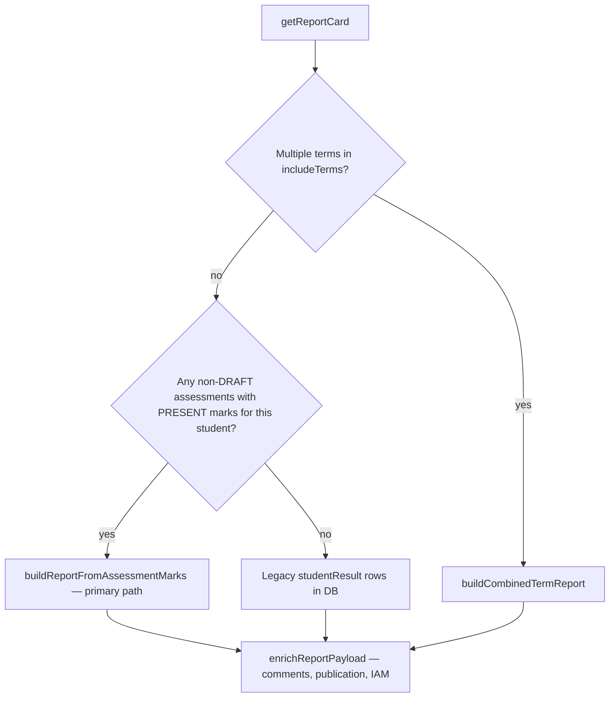

# Report cards — marks calculation, ordering, and organization

This document describes how **Academic report cards (v2)** are built from **TichaPortal / Academic assessment marks**, including formulas, sort order, and class **position** (rank). Implementation lives mainly in `Academic/Backend/src/services/grading-engine.service.ts` and the UI in `Academic/Frontend_react/src/components/ModernStudentReportCard.tsx`.

---

## 1. Which code path runs?

When you open a report for a student (`GET /grading/report-card/:studentId/:classId/:academicYear?term=…`):



**Most schools today use path E** after teachers enter and submit marks in TichaPortal.

Assessments included:

- Same `organizationId`, `classId`, `academicYear`, and `term` (if provided).
- `status !== 'DRAFT'` (submitted / reviewed / approved / locked, etc.).
- Only marks with `markStatus === 'PRESENT'` and non-null `score`.

---

## 2. Configuration inputs (what drives numbers)

| Input | Source | Used for |
|--------|--------|----------|
| **Assessment template** | Most common `templateId` on class assessments, else active **template assignment** for class+year+term | Component names, **weights** (QUIZ 50%, EXAM 50%), fallback **default course marks** |
| **DEFAULT (course total)** per subject | **Academic → Courses → Course catalog** (`course_default_marks` per class/subject/term), then Timetable class catalog, then template `defaultCourseMarks` (often 100) | Column **DEFAULT**, component caps, **course result** denominator |
| **Assessment max** | Each assessment’s `maxMark` (what teachers see in Marks review, e.g. 40 or 25) | Raw % for that quiz: `score / maxMark` |
| **Template component** | Assessment linked to template component (name + `weightPercentage`) | Which column (QUIZ / EXAM) receives the mark |
| **Grading scale** | Org scale by template level + class hint (PRIMARY, etc.) | Letter **grade** on report |
| **Core / non-core** | Timetable course config (`isCore`) | **Row order** on report (core block first) |

---

## 3. From teacher mark to report cell (primary path)

### Step A — Group marks

For every assessment in the term:

1. **Component key** = `assessment.component.name` OR `assessment.title` OR `"Assessment"`.
2. For each **PRESENT** mark with a score:
   - `pct = (score / maxMark) × 100` where `maxMark` = mark’s `maxMark` or assessment `maxMark`.
3. Accumulate **per student → per subject → per component**:
   - `pctSum`, `pctCount` (for averaging multiple quizzes in the same component).
   - `scoreSum`, `maxSum` (sums of raw scores and maxes — used for **raw** display when there is exactly one assessment).

Implementation: `src/utils/report-card-component-calc.ts` (used by `grading-engine.service.ts`).

### Step B — Normalize to course total (`buildSubjectScoresFromComponents`)

For each subject, let **DEFAULT** = `subjectDefaultMarks[subjectId]` (from course catalog) or template default.

For each template component name (in template `sortOrder`, or discovered from assessments):

| Symbol | Formula |
|--------|---------|
| **weight** | Template `weightPercentage` if &gt; 0; else component weight; else `100 / number of components` |
| **normalizedMax** | `DEFAULT × weight / 100` → e.g. DEFAULT 40, QUIZ 50% → **20** |
| **avgPct** | If any marks in component: `pctSum / pctCount` (average % across quizzes in that component) |
| **normalizedScore** | `avgPct / 100 × normalizedMax` |
| **subject totalScore** | Sum of `normalizedScore` over all components that have marks |
| **subject totalMax** | `DEFAULT` |
| **subject percentage** | `(totalScore / DEFAULT) × 100` if any component has marks, else 0 |

**Report columns:**

| UI column | Meaning |
|-----------|---------|
| **DEFAULT** | Course total marks (catalog) |
| **QUIZ 50%** / **EXAM 50%** | Shows **normalizedScore / normalizedMax** (scaled to course), not necessarily the teacher’s quiz max (e.g. 25) |
| **rawMarksDisplay** (API) | e.g. `20/40` entered, or `% average (2 assessments)` — UI may show this under the scaled cell |
| **Course result** | `totalScore / DEFAULT` |
| **Total %** | Subject `percentage` |
| **Grade** | Letter from grading scale applied to subject `percentage` |
| **Position** | Class rank for that **subject** when **courseComplete** (all weighted template components have marks) — see §5 |
| **courseComplete** | `false` if any template component (weight &gt; 0) has no marks — grade/rank withheld; UI shows **Partial** |

### Example (matches common confusion)

| Subject | DEFAULT | Quiz entered | Quiz max | Component weight |
|---------|---------|--------------|----------|------------------|
| Mathematics | 40 | 20 | 40 | QUIZ 50% |
| C.A | 20 | 13 | 25 | QUIZ 50% |

- Math: avgPct = 50% → normalizedScore = 10 → display **20/20** if full marks; course **20/40** if only quiz entered.
- C.A: avgPct = 52% → normalizedMax = 10 → normalizedScore ≈ 5.2 → display **~5.2/10**; course **~5.2/20**. Marks review still shows **13/25**.

---

## 4. Overall summary on the report

For each student in the class (among students with at least one mark):

```text
overallScore = ( Σ totalScore over subjects with marks ) / ( Σ DEFAULT over those subjects ) × 100
```

This is **not** the simple average of subject percentages unless every subject has the same DEFAULT and all subjects have marks.

**Overall position** on the report header uses `overallScore` with **competition ranking (ties)** — see §5.

Insights (**strong courses** / **needs improvement**) sort subjects by **percentage** (top 3 / bottom 3) — this is separate from **table row order**.

---

## 5. Ranking and “Position” (class order)

### Subject position (`rank / classSize`)

- Computed **per subjectId** across all students in the class who have a valid subject **percentage** (≥ 0 in the internal map).
- Sort students by subject **percentage** descending.
- **Tie rule:** `rankWithTies` — standard competition ranking: tied percentages share the same rank; next rank skips (1, 1, 3, 4…).
- **classSize** = number of students with marks in that subject (not always whole class enrollment).

Students with **no marks** in a subject: `marksEntered: false`, position shown as **—**, grade **—**.

### Overall position (`position / classSize` on report)

- Same tie algorithm on **overallScore** (§4).
- Only students who appear in the aggregated class report (at least one PRESENT mark in the term) are eligible.

### Legacy `calculateFinalResults` (template engine API)

Separate workflow used when persisting **studentResult** via template calculation:

- Ranks by `finalPercentage` with **dense** rank (1, 2, 3…) — **no** tie skip.
- Report card path **E** uses `rankWithTies`, not this rank.

---

## 6. Subject and column **display order** (not rank order)

These are the usual causes of “order problems” on the PDF/UI:

### 6.1 Subject rows on the report table

After scores are computed, subjects are sorted by **`applyCoreFlagsAndSort`**:

1. **Core subjects first** (`isCore !== false`).
2. **Non-core** subjects after.
3. Within each group: **alphabetical by subject name** (`localeCompare`).

The **#** column is this display index (1, 2, 3…), **not** position in class.

Subjects with **no marks** may still appear:

- Placeholders from assessments for the class.
- Extra courses merged from **Timetable class catalog** (`mergeTimetableCoursesIntoSubjects`) with empty scores.

### 6.2 Component columns (QUIZ, EXAM, …)

Order is **`componentOrder`** on the API:

1. Template components: `sortOrder ASC` (active only).
2. Else: unique component names from assessments ordered by `component.sortOrder`, then assessment date.

UI (`ModernStudentReportCard`): prefers `assessmentTemplate.components`, then `componentOrder`, then keys from first subject with marks.

### 6.3 Strong / weak course lists

Sorted by **subject percentage** (performance), not alphabetical and not core-first.

---

## 7. Multiple quizzes in one component

If two assessments map to the same component (e.g. two QUIZ entries):

- **Percentage** for the component = **average** of each assessment’s `(score/maxMark)×100`.
- **normalizedScore** uses that average.
- **rawMarksDisplay** = `"XX% average (2 assessments)"` when `pctCount > 1`.

Teachers should use consistent max marks per component type where possible; mismatched maxes still average **percentages**, not raw points.

---

## 8. Combined multi-term reports

When `includeTerms` has multiple terms:

- One row per subject; **`termResults[]`** holds per-term scores, grades, ranks.
- Subject list order still **core first, then name**.
- Each term can have its own **`componentOrder`**.

---

## 9. Grades

- Subject grade: `matchGradeScale(subjectPercentage, gradingScale)` with small tolerance on band edges.
- Scale chosen by template academic level and class name/category heuristics (PRIMARY, NURSERY, etc.).
- Missing scale → grade may be null.

Pass rate elsewhere (e.g. marks review statistics) often uses **50%** threshold; report **position** does not use pass/fail, only percentage ordering.

---

## 10. Troubleshooting checklist

| Symptom | Likely cause |
|---------|----------------|
| QUIZ shows **/20** vs **/10** | **DEFAULT** differs (40 vs 20); component max = DEFAULT × weight% |
| Course result doesn’t match quiz | Only part of template entered (e.g. QUIZ 50% without EXAM 50%) |
| Position seems wrong | Ties (1,1,3); or compared students without marks excluded from **classSize** |
| Subject order “random” | Actually **core A–Z**, then **non-core A–Z** — not sorted by score |
| Extra empty subjects | Timetable catalog merge or class assessments without marks yet |
| Different rank in template results vs report | Template API uses dense rank; report uses **rankWithTies** |
| No report at all | No non-DRAFT assessments with PRESENT marks for student/term |

---

## 11. Related files

| Area | Path |
|------|------|
| Report build | `Academic/Backend/src/services/grading-engine.service.ts` |
| Course DEFAULT storage | `Academic/Backend/src/services/course-default-marks.store.ts` |
| Report enrichment | `Academic/Backend/src/services/report-card.service.ts` |
| Report UI | `Academic/Frontend_react/src/components/ModernStudentReportCard.tsx` |
| Teacher marks → Academic | TichaPortal → Academic `POST /assessments/:id/marks`, submit workflow |
| Course totals UI | `Academic/Frontend_react/src/pages/CourseCatalogPage.tsx` |

---

## 12. Quick formula reference

```text
quizPct          = score / assessmentMaxMark × 100
componentAvgPct  = mean(quizPct) over assessments in that component
normalizedMax    = DEFAULT × componentWeight / 100
normalizedScore  = componentAvgPct / 100 × normalizedMax
subjectPct       = sum(normalizedScore) / DEFAULT × 100
overallPct       = sum(subjectTotalScore) / sum(subjectDEFAULT) × 100   (subjects with marks only)
```

**Display order:** core subjects → alphabetical; **rank order:** by percentage (ties share rank).
