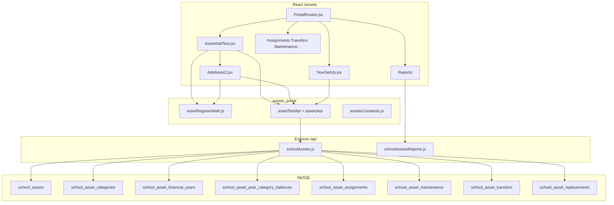

# Assets Portal — Architecture

## System overview



---

## Design principles

1. **Register-first** — `/api/school/assets/test/*` is the KPS ledger source of truth.  
2. **Dual math** — Frontend `assetRegisterMath.js` must stay aligned with backend `computeAssetRegisterMath`.  
3. **Chain by category+year** — Rows ordered by `id ASC`; opening rolls from prior row TB; accumulated dep stays fixed at year-start.  
4. **Persist on write** — Create/update/import should call `recalcRegisterChainInCategory` (+ year totals).  
5. **Display enrichment** — Table uses `enrichRegisterChainFinancials` so UI matches edit form.

---

## Database model

| Table | Purpose |
|-------|---------|
| `school_assets` | Register rows (financial columns, health, building_status, soft-delete) |
| `school_asset_categories` | Name + `depreciation_rate` |
| `school_asset_financial_years` | FY Draft / Active / Closed + totals |
| `school_asset_year_category_balances` | Per year × category opening, purchases, annual dep, closing |
| `school_asset_assignments` | Assign / return |
| `school_asset_maintenance` | Maintenance tickets |
| `school_asset_transfers` | Location moves |
| `school_asset_replacements` | Replacement workflow |

### Important `school_assets` columns

| Column | Meaning |
|--------|---------|
| `register_year` | Ledger year |
| `opening_amount` | O |
| `unit_price` / purchase | PP |
| `total_balance` | TB = O + PP |
| `accumulated_depreciation` | TD (year-start) |
| `dep_rate` | R % |
| `annual_dep` | AD |
| `total_dep` | TDep |
| `net_book_value` | NBV |
| `building_status` | Finished / Working Progress (Buildings) |
| `asset_health_status` | Good / Fair / … |
| `assets_status` | Workflow status |
| Unique | `(school_id, asset_code, register_year)` |

---

## Frontend layout

```
assets_portal/                 Portal shell
├── PortalRoutes.jsx
├── services/                  API clients
├── utils/                     Math, Excel, QR, constants
└── Docs/                      Package-local docs copy

Assets System/src/
├── pages/                     Screens
└── components/                Sidebar, AddAsset2, tables, modals
```

---

## Backend layout

```
BabyeyiRoutes/schoolAssets.js
├── Schema ensure / migrations
├── Math (mirror of assetRegisterMath)
├── resolveCategoryOpeningContext
├── registerAssetWithLedger
├── registerAssetsBulkWithLedger
├── recalcRegisterChainInCategory
├── Year balance updates
└── REST routes (/test, categories, FY, ops)

BabyeyiRoutes/schoolAssetsReports.js
└── GET /school/assets/reports/:type
```

---

## Auth layers

| Layer | Rule |
|-------|------|
| ProGate (UI) | `ASSETS_MANAGER` / `ASSET_MANAGER` only |
| API read | Broader school roles + accountant |
| API write | Read roles except `ACCOUNTANT` |
| Public scan | No auth |

---

## Sidebar map

| Group | Pages |
|-------|-------|
| Top | Dashboard |
| Asset Management | Register, Year Setup, Analytics, Categories |
| Reports | 12 report types |
| Operations | Assignments, Returns, Transfers, Replacements, Maintenance, Purchase Requests |

Hidden but routed: Inventory, Audit, QR tools, Users, Settings, Depreciation page, etc.
