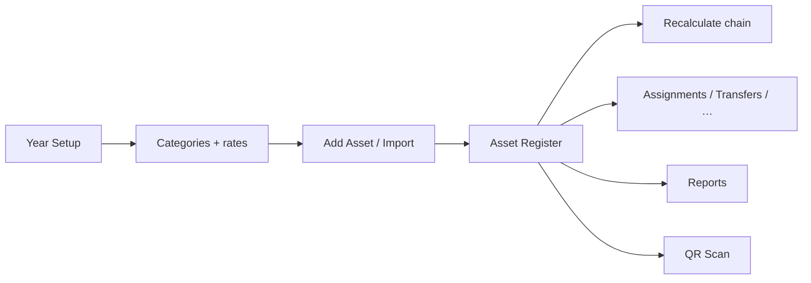

# Assets Portal — Documentation Hub

> **Portal path:** `/assets`  
> **UI pages:** `babyeyipro/Frontend/web/src/Assets System/src/`  
> **Portal shell:** `babyeyipro/Frontend/web/src/assets_portal/`  
> **Backend:** `BabyeyiSystem/backend/BabyeyiRoutes/schoolAssets.js` + `schoolAssetsReports.js`  
> **Also mirrored:** `assets_portal/Docs/` (same suite under the portal package)

Modern developer documentation for the **Babyeyi Assets Manager Portal** — KPS-style register, year setup, depreciation math, operations, reports, and full backend logic.

---

## Quick start

```bash
# Backend
cd BabyeyiSystem/backend
npm install && npm run dev          # http://localhost:5100

# Frontend
cd babyeyipro/Frontend/web
npm install && npm run dev          # http://localhost:5174/assets
```

| Env | Purpose |
|-----|---------|
| `VITE_API_URL` | Backend origin (default `http://localhost:5100`) |

**UI roles:** `ASSETS_MANAGER` or `ASSET_MANAGER`  
**API write:** same + school admins/managers (not ACCOUNTANT)  
**API read:** write roles + `ACCOUNTANT`, `DOS`, etc.

---

## Documentation index

### Feature guides

| Document | Description |
|----------|-------------|
| [**FEATURES_INDEX.md**](./FEATURES_INDEX.md) | Chapter hub + learning paths |
| [**FEATURES_COMPLETE.md**](./FEATURES_COMPLETE.md) | **All features in one manual** (Word-friendly) |
| [**features/**](./features/) | Step-by-step chapters |

### Technical & backend

| Document | Description |
|----------|-------------|
| [**00-architecture.md**](./00-architecture.md) | System diagram, tables, data flow |
| [**DEVELOPER_GUIDE.md**](./DEVELOPER_GUIDE.md) | Onboarding, extending features, pitfalls |
| [**BACKEND_LOGIC.md**](./BACKEND_LOGIC.md) | **Deep backend** — ledger create, bulk qty, year balances, recalc |
| [**API_REFERENCE.md**](./API_REFERENCE.md) | All `/api/school/assets*` endpoints |
| [**BUSINESS_RULES.md**](./BUSINESS_RULES.md) | Depreciation formulas, Land, Buildings WIP |
| [**CALCULATION_ENGINE.md**](./CALCULATION_ENGINE.md) | FE/BE math functions map |
| [**DOC_STANDARDS.md**](./DOC_STANDARDS.md) | How to extend these docs |

---

## Production vs legacy (critical)

| Area | **Use this** | Avoid |
|------|--------------|--------|
| Register UI | `/assets/asset-add-test` → `AssetAddTest.jsx` | `/assets/inventory` |
| Register API | `/api/school/assets/test/*` | Legacy `/api/school/assets` CRUD for new work |
| Math | `assetRegisterMath.js` + backend mirror | `assetsCalculations.js` alone |
| Add wizard | `AddAsset2.jsx` | Legacy `AddAsset.jsx` |

---

## Core workflow



1. Seed **Categories** (with depreciation rates)  
2. Create **Financial Year** + category openings  
3. **Add** assets (or Excel import) for that year  
4. Review **Register**; run **Recalculate** after bulk/import  
5. Run **Operations** and **Reports** as needed  

---

## Key files

| Layer | Path |
|-------|------|
| Routes | `assets_portal/PortalRoutes.jsx` |
| Register page | `Assets System/src/pages/AssetAddTest.jsx` |
| Add/Edit wizard | `Assets System/src/components/AddAsset2.jsx` |
| Year Setup | `Assets System/src/pages/YearSetUp.jsx` |
| Register math (FE) | `assets_portal/utils/assetRegisterMath.js` |
| Register API client | `assets_portal/services/assetTestApi.js` |
| Backend (~6.6k lines) | `BabyeyiRoutes/schoolAssets.js` |
| Reports backend | `BabyeyiRoutes/schoolAssetsReports.js` |

---

## Export to Word

```powershell
cd babyeyipro/docs/assets-portal
pandoc FEATURES_COMPLETE.md -o word/Assets-Portal-Complete-Manual.docx --toc --toc-depth=3
pandoc README.md 00-architecture.md DEVELOPER_GUIDE.md BACKEND_LOGIC.md API_REFERENCE.md BUSINESS_RULES.md CALCULATION_ENGINE.md -o word/Assets-Portal-Developer-Pack.docx --toc --toc-depth=2
```

---

*Babyeyi Assets Portal — Developer Documentation Hub*
