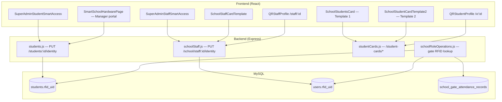

# Super Admin — Smart Access & ID Cards (Developer Guide)

End-to-end reference for **RFID / fingerprint assignment**, **student & staff ID card generation**, and **QR public profiles** in Babyeyi. Covers Super Admin UI, shared school-manager portals, backend APIs, database columns, and hardware integration.

> **Terminology:** The product uses **RFID** (radio-frequency ID from a physical smart card). Some users say “RQFID”; there is no separate `rqfid` field — values are stored in `rfid_uid`.

---

## 1. What this module does

| Capability | Purpose |
|------------|---------|
| **Student Smart Access** | Bind `rfid_uid` and/or `fingerprint_id` to a `students` row |
| **Staff Smart Access** | Bind credentials to a `users` row (staff account) + upload photo |
| **School Students Card (Template 1)** | Landscape ID cards — html2canvas + server bulk PDF |
| **Student Card Template 2** | Portrait ID cards — canvas renderer + client ZIP bulk export |
| **Staff Card Template** | Portrait staff cards — canvas + ZIP bulk export |
| **QR public profiles** | Scan printed QR → public student/staff profile (no login) |
| **Gate attendance** | Gate scanners look up `rfid_uid` on students/staff and write attendance |

**Important distinction**

- **RFID** = hardware chip UID stored in the database; used at gates and classroom scanners.
- **QR on printed cards** = URL encoded in the card image; opens a **public web profile**. QR and RFID are independent.

---

## 2. Architecture



---

## 3. Navigation & routes (frontend)

### 3.1 Super Admin sidebar

Defined in `BabyeyiSystem/frontend/src/Pages/SuperAdmin/components/superAdminNavConfig.js` under group **Smart Access & IDs**:

| Nav label | Route | Page id |
|-----------|-------|---------|
| Student Smart Access | `/superadmin/smart-access/students` | `smart-access-students` |
| Staff Smart Access | `/superadmin/smart-access/staff` | `smart-access-staff` |
| School Students Card | `/superadmin/school-students-card` | `school-students-card` |
| Student Card Template 2 | `/superadmin/student-card-template-2` | `student-card-template-2` |
| Staff Card Template | `/superadmin/school-staff-card-template` | `school-staff-card-template` |

Registered in `BabyeyiSystem/frontend/src/App.jsx` (Super Admin layout). Requires roles `SUPER_ADMIN` or `FULL_SYSTEM_CONTROLLER`.

### 3.2 Public QR routes (no auth)

Also in `App.jsx`:

| Route | Component | QR payload example |
|-------|-----------|-------------------|
| `/v/:studentId` | `QRStudentProfile.jsx` | `https://babyeyi.rw/v/150010001` |
| `/qr-student-profile/:studentId` | same | legacy alias |
| `/staff/:staffId` | `QRStaffProfile.jsx` | `https://babyeyi.rw/staff/TEA-001` |
| `/qr-staff-profile/:staffId` | same | legacy alias |

`:studentId` and `:staffId` accept **student_code / staff_id** strings or numeric DB ids (backward compatible).

### 3.3 School Manager (same APIs, school-scoped)

| Page | Path | Notes |
|------|------|-------|
| Smart School Hardware | Manager `SmartSchoolHardwarePage.jsx` | Student RFID workflow; uses session `school_id` |
| Staff Smart Access | `StaffSmartAccessPage.jsx` | Staff identity for one school |
| Card templates | `lite/teacher/pages/CardTemplate.jsx` | Template 2 variant for teachers |

Super Admin pages pass `?school_id=` or pick school via `SmartAccessSchoolToolbar`.

---

## 4. Frontend file map

| Area | Path |
|------|------|
| Student Smart Access (SA) | `frontend/src/Pages/SuperAdmin/SmartAccess/SuperAdminStudentSmartAccess.jsx` |
| Staff Smart Access (SA) | `frontend/src/Pages/SuperAdmin/SmartAccess/SuperAdminStaffSmartAccess.jsx` |
| School picker toolbar | `frontend/src/Pages/SuperAdmin/SmartAccess/SmartAccessSchoolToolbar.jsx` |
| Smart Access axios client | `frontend/src/Pages/SuperAdmin/SmartAccess/smartAccessApi.js` |
| Dashboard school peek links | `frontend/src/Pages/SuperAdmin/SmartAccess/SuperAdminDashboardSchoolPeek.jsx` |
| Student cards Template 1 | `frontend/src/Pages/SuperAdmin/SchoolStudentsCard.jsx` |
| Student cards Template 2 | `frontend/src/Pages/SuperAdmin/SchoolStudentCardTemplate2.jsx` |
| Staff card template | `frontend/src/Pages/SuperAdmin/SchoolStaffCardTemplate.jsx` |
| Public student QR page | `frontend/src/Pages/SuperAdmin/QRStudentProfile.jsx` |
| Public staff QR page | `frontend/src/Pages/SuperAdmin/QRStaffProfile.jsx` |
| Nav config | `frontend/src/Pages/SuperAdmin/components/superAdminNavConfig.js` |
| Manager student hardware | `frontend/src/manager/pages/SmartSchoolHardwarePage.jsx` |
| DOS identity modal | `frontend/src/lite/dos/components/StudentIdentityRegistrationModal.jsx` |

### 4.1 Shared frontend patterns

**Smart Access API client** (`smartAccessApi.js`):

```javascript
baseURL: `${VITE_API_URL}/api`
withCredentials: true  // session cookie
```

**Web Serial (RFID reader)** — used in student/staff Smart Access pages:

- Browser: Chrome or Edge, desktop, HTTPS or `localhost`
- Baud rate: `115200`
- USB vendor filters: Espressif `0x303A`, Seeed `0x2886`, Silicon Labs `0x10c4`, CH340 `0x1a86`, FTDI `0x0403` (falls back to all serial ports)
- Incoming line protocol (see §8)

**Card export dependencies** (`frontend/package.json`): `jspdf`, `html2canvas` (Template 1), `jszip` (bulk ZIP on Template 2 & staff).

---

## 5. Backend file map

| Area | Path |
|------|------|
| Student identity API | `backend/BabyeyiRoutes/students.js` |
| Staff identity + staff card list | `backend/BabyeyiRoutes/schoolStaff.js` |
| Student card PDF/list/public | `backend/BabyeyiRoutes/studentCards.js` |
| Gate RFID resolution | `backend/BabyeyiRoutes/schoolRoleOperations.js` |
| Teacher class RFID check-in | `backend/lib/classRoomScan.js` |
| Route mount | `backend/server.js` → `app.use('/api', studentCardsRoutes)` |
| Core auth columns | `backend/utils/coreAuthSchema.js` |

---

## 6. Database schema

Columns are added lazily via `ALTER TABLE` on first use (safe to run on older DBs).

### 6.1 `students`

| Column | Type | Purpose |
|--------|------|---------|
| `rfid_uid` | `VARCHAR(64) NULL` | Normalized uppercase card UID |
| `fingerprint_id` | `VARCHAR(128) NULL` | Device fingerprint slot id |
| `identity_remarks` | text/varchar | Optional notes |
| `student_photo` | filename | Profile photo for cards |

Index: `idx_students_school_rfid (school_id, rfid_uid)` — enforces uniqueness per school in application logic.

### 6.2 `users` (staff accounts)

| Column | Type | Purpose |
|--------|------|---------|
| `rfid_uid` | `VARCHAR(64) NULL` | Staff card UID (uppercase) |
| `fingerprint_id` | `VARCHAR(128) NULL` | Fingerprint id |
| `identity_remarks` | `VARCHAR(512) NULL` | Notes |
| `photo` | path | Staff photo (`/uploads/profile-photos/` or identity photos) |

Staff RFID uniqueness: per `school_id` among non-deleted users (`assertRfidAvailable` in `schoolStaff.js`).

### 6.3 Optional cache

`student_card_cache` — created by `POST /api/student-cards/cache/refresh/:studentId` (used after identity photo updates from DOS modal).

### 6.4 Gate attendance

`school_gate_attendance_records`, `school_gate_logs`, `school_gate_attendance_events` — populated when gate APIs resolve a scanned `card_uid` to a student or staff member.

---

## 7. Roles & authorization

| Feature | Allowed roles |
|---------|----------------|
| Student identity `PUT /students/:id/identity` | School roles + `SUPER_ADMIN`, `FULL_SYSTEM_CONTROLLER` (`STUDENT_IDENTITY_ROLES`) |
| Staff list/identity (school) | `SMART_ACCESS_STAFF_ROLES` = school creators + SA |
| Staff card list `GET /staff` | `STAFF_CARD_ROLES` = SA + school admin/manager/DOS/accountant |
| Student cards API | `SUPER_ADMIN`, `FULL_SYSTEM_CONTROLLER`, `SCHOOL_ADMIN`, `SCHOOL_MANAGER`, `DOS` |
| Public QR profiles | **No auth** |

Super Admin passes `school_id` as query param. School portals use session school id via `resolveEffectiveSchoolId(req)`.

Staff Smart Access for non-Pro schools may return `403` with `code: 'PRO_REQUIRED'` (`ensureProSchoolForStaffFeature`).

---

## 8. RFID hardware protocol (Web Serial)

The firmware sends **newline-terminated** ASCII lines. Frontend handlers in `SuperAdminStudentSmartAccess.jsx` / `SuperAdminStaffSmartAccess.jsx`:

| Line prefix | Meaning | Frontend action |
|-------------|---------|-----------------|
| `CARD:<uid>` | RFID scanned | `PUT .../identity` with `rfid_uid: uid` |
| `FPID:<id>` | Fingerprint enrolled | Save `fingerprint_id` |
| `EXIST:<id>` | Fingerprint already on device | Sync id to record |
| `FPDEL:<id>` | Deleted on device | Clear local fp if it matches |
| `STEP:PLACE_FINGER` etc. | UI prompts | Update instruction text only |

**Outbound commands** (written to serial port):

| Command | Effect |
|---------|--------|
| `ENROLL\n` | Start fingerprint enrollment |
| `DELETE:<id>\n` | Delete fingerprint slot on device |

**Manual fallback:** identity modal accepts typed `rfid_uid` / `fingerprint_id` and calls the same REST endpoints.

**Staff RFID normalization (backend):** `normalizeRfidUid()` trims and uppercases before save and duplicate check.

---

## 9. REST API reference

Base URL: `{API}/api` (default `http://localhost:5100/api`). Session cookie required except public routes.

### 9.1 Student identity

#### `PUT /students/:id/identity`

**Query:** `school_id` (required for Super Admin)

**Body** (all fields optional; omitted = unchanged; `null` = clear):

```json
{
  "rfid_uid": "A1B2C3D4",
  "fingerprint_id": "12",
  "identity_remarks": "Replaced lost card"
}
```

CamelCase aliases: `rfidUid`, `fingerprintId`, `identityRemarks`.

**Success `200`:**

```json
{
  "success": true,
  "message": "Identity credentials saved",
  "data": {
    "id": 893,
    "rfid_uid": "A1B2C3D4",
    "fingerprint_id": "12",
    "identity_remarks": "Replaced lost card"
  }
}
```

**Conflict `409`:**

```json
{
  "success": false,
  "code": "RFID_DUPLICATE",
  "message": "This card (A1B2C3D4) is already assigned to another learner..."
}
```

Codes: `RFID_DUPLICATE`, `FINGERPRINT_DUPLICATE`.

#### `PUT /students/:id/identity/photo`

Multipart field `photo` — JPEG/PNG/WebP, updates `student_photo`.

### 9.2 Staff identity

#### `GET /school/staff?school_id=`

List staff for Smart Access. Returns `rfid_uid`, `fingerprint_id`, roles, etc.

#### `PUT /school/staff/:userId/identity?school_id=`

Same body shape as student identity. Duplicate RFID returns `409` with message (no separate code field).

#### `POST /school/staff/:userId/photo`

JSON `{ "photoBase64": "...", "mimeType": "image/jpeg" }` or multipart `photo`.

### 9.3 Student cards

| Method | Path | Description |
|--------|------|-------------|
| `GET` | `/student-cards/students` | Filtered list for card UI |
| `GET` | `/student-cards/filters/schools` | Schools by province/district/sector |
| `GET` | `/student-cards/filters/classes?school_id=` | Distinct class names |
| `GET` | `/student-cards/:studentId/template` | Full card payload + QR data URL |
| `GET` | `/student-cards/:studentId/pdf` | Server PDF (Template 1 layout) |
| `POST` | `/student-cards/bulk/pdf` | Body `{ "student_ids": [1,2,3] }`, max 300 |
| `POST` | `/student-cards/cache/refresh/:studentId` | Refresh optional cache row |
| `GET` | `/students/public/:id` | **Public** profile for QR page |

**List query params:** `province`, `district`, `sector`, `school_id`, `class_name`, `q`, `limit` (max 500).

**Template payload** includes: `student_code`, `full_name`, `class_name`, `school_logo_path`, `student_photo_path`, `qr_content`, `qr_data_url`, head teacher fields, etc.

### 9.4 Staff cards

| Method | Path | Description |
|--------|------|-------------|
| `GET` | `/staff` | Cross-school staff list (SA filters) |
| `GET` | `/staff/filters/roles` | Distinct role codes |
| `GET` | `/staff/public/:id` | **Public** staff profile for QR |

**Staff list query params:** `province`, `district`, `sector`, `school_id`, `role`, `q`, `limit` (max 500).

Staff cards are rendered **entirely on the client** (`SchoolStaffCardTemplate.jsx`); there is no server PDF route for staff.

### 9.5 Locations (shared filters)

`GET /locations/provinces`, `/locations/districts?province=`, `/locations/sectors?province=&district=`

---

## 10. ID card templates (developer comparison)

| | Template 1 (`SchoolStudentsCard`) | Template 2 (`SchoolStudentCardTemplate2`) | Staff (`SchoolStaffCardTemplate`) |
|---|-----------------------------------|-------------------------------------------|-----------------------------------|
| Orientation | Landscape 640×400 | Portrait 320×695 | Portrait 320×695 |
| Renderer | DOM + html2canvas | Canvas @ 3× scale | Canvas @ 3× scale |
| QR source | Server `qr_data_url` or decorative SVG | `api.qrserver.com` + `/v/:studentCode` | QR → `/staff/:staffCode` |
| Single export | PNG, JPEG, PDF (client), PDF (server) | PNG, JPEG, PDF (client), PDF (server) | PNG, JPEG, PDF |
| Bulk export | `POST /student-cards/bulk/pdf` | Client ZIP (`bulkDownloadZip`) | Client ZIP (`bulkStaffDownloadZip`) |
| QR identifier | Prefer `student_code` | **`studentCode` not DB id** | **`staffCode` not DB id** |

### 10.1 QR URL construction (Template 2)

```javascript
// SchoolStudentCardTemplate2.jsx
const origin = VITE_PUBLIC_SITE_URL || window.location.origin  // must be https://
const url = `${origin}${basePath}/v/${encodeURIComponent(studentCode)}`;
```

If `VITE_PUBLIC_SITE_URL` is missing or not a full URL, phone scanners may open a broken link.

### 10.1 Public assets for cards

| Asset | Location |
|-------|----------|
| School logo | `schools.logo_url` → `/uploads/...` |
| Student photo | `/uploads/student-profile-photos/{filename}` |
| Staff photo | `/uploads/staff-identity-photos/` or user `photo` |
| Country emblem (Template 1) | `public/countrylogo.png` |
| Shule footer logo | `public/ShuleCardLogo.png`, fallbacks in component |

---

## 11. End-user workflows (for docs / training)

### 11.1 Assign RFID to a student (Super Admin)

1. Open **Student Smart Access**.
2. Select school (location toolbar).
3. Filter by class; click **Assign card** on a row.
4. **Connect device** → scan card (or type UID → **Save identity**).
5. Optional: enroll fingerprint via **ENROLL** command flow.
6. Use **Switch learner** to assign the next student without closing the modal.

### 11.2 Generate student cards (Template 2 — recommended)

1. Open **Student Card Template 2**.
2. Filter Province → District → Sector → School → Class.
3. Click **Apply filters**.
4. Preview one student → download PNG/JPEG/PDF, **or** select rows → **ZIP N cards**.
5. Print and laminate; RFID assignment is a separate step (§11.1).

### 11.3 Staff: photo + RFID + card

1. **Staff Smart Access** → Step 1 pick person → Step 2 upload photo → Step 3 scan RFID/fp.
2. **Staff Card Template** → filter school → preview → download or ZIP bulk.

---

## 12. Gate attendance (downstream consumer)

When a gate device posts a card UID, `schoolRoleOperations.js` resolves:

1. `students` where `UPPER(TRIM(rfid_uid))` matches (student)
2. Else `users` where `rfid_uid` matches (staff)

Successful scans insert/update `school_gate_attendance_records` and log events. Ensure UIDs assigned in Smart Access match what the physical reader sends (normalization is uppercase on staff; student UIDs stored as scanned).

Related UI: DOS/Discipline **Gate Attendance**, **RFIDScanner** components under `frontend/src/lite/dos/` and `lite/discipline/`.

---

## 13. Environment variables

### Frontend (`.env` / Vite)

| Variable | Used for |
|----------|----------|
| `VITE_API_URL` | API root (default `http://localhost:5100`) |
| `VITE_UPLOADS_BASE` | Photo/logo URLs on cards |
| `VITE_PUBLIC_SITE_URL` | **Required for production QR** — full origin e.g. `https://babyeyi.rw` |

### Backend (`.env`)

| Variable | Used for |
|----------|----------|
| `PUBLIC_APP_BASE_URL` | Legacy QR in server PDF (`studentCards.js`) |
| `COUNTRY_LOGO_URL` | Optional path for PDF cards |
| `FRONTEND_URL` | Fallback links |

---

## 14. Developer tasks

### 14.1 Add a field to printed student cards

1. Extend SQL in `getStudentCardRow()` / list query in `studentCards.js`.
2. Map field in `getStudentCardPayload()`.
3. Update `mapRowToStudent()` in Template 1 & 2.
4. Draw field in `renderCardToCanvas()` (T2) or `IDCard` component (T1) and `drawCardPage()` (server PDF).

### 14.2 Add a field to staff cards

1. Extend `GET /staff` SELECT in `schoolStaff.js`.
2. Update `mapRowToStaff()` and `renderStaffCardToCanvas()` in `SchoolStaffCardTemplate.jsx`.

### 14.3 Debug duplicate RFID

- Check `students` / `users` for same `school_id` + `rfid_uid`.
- Clear with `PUT .../identity` body `{ "rfid_uid": null }`.
- Staff UIDs are uppercased; compare with `UPPER(TRIM(...))` in gate queries.

### 14.4 Test public QR locally

1. Set `VITE_PUBLIC_SITE_URL=http://localhost:5173`.
2. Generate card for student with known `student_code`.
3. Open `http://localhost:5173/v/{student_code}` — should hit `GET /api/students/public/:id`.

### 14.5 Test Web Serial without hardware

Use manual UID entry in the identity modal, or mock `handleSerialLine('CARD:TEST123')` in devtools (component exposes flow via `patchStudent` / `patchIdentity`).

---

## 15. Troubleshooting

| Symptom | Likely cause | Fix |
|---------|--------------|-----|
| Connect device disabled / fails | Browser not Chrome/Edge or not secure context | Use HTTPS or localhost |
| RFID saved but gate ignores scan | UID mismatch (case/format) | Compare reader output with DB value; normalize |
| 409 on assign | UID already used in same school | Clear other person’s card or use new card |
| Staff list 403 PRO_REQUIRED | School subscription | Pro feature gate on staff APIs |
| QR opens homepage only | Bad `VITE_PUBLIC_SITE_URL` | Set full `https://domain` |
| QR 404 on profile | Wrong id in QR (DB id vs code) | Regenerate card using `student_code` |
| Bulk PDF empty | No photos / invalid ids | Check `student_ids`; max 300 |
| ZIP bulk slow | Many cards, 4 parallel renders | Expected; progress bar in UI |
| Template 1 QR looks fake | Decorative SVG fallback | Use server template endpoint or Template 2 |
| CORS taint on canvas export | Cross-origin images | Template 2 uses `fetch`→blob loader |

---

## 16. Related code (outside Super Admin)

| Feature | Location |
|---------|----------|
| Manager student RFID | `frontend/src/manager/pages/SmartSchoolHardwarePage.jsx` |
| Student service identity | `frontend/src/manager/services/studentService.js` |
| DOS identity modal | `frontend/src/lite/dos/components/StudentIdentityRegistrationModal.jsx` |
| HR staff identity | `frontend/src/Pages/School Manager/components/StaffIdentityModal.jsx` |
| Gate attendance UI | `frontend/src/Pages/School Manager/components/GateAttendancePage.jsx` |

These reuse the same **`PUT /students/:id/identity`** and staff identity endpoints documented above.

---

## 17. Quick file checklist

```
BabyeyiSystem/
├── docs/SUPER_ADMIN_SMART_ACCESS_AND_ID_CARDS.md   ← this guide
├── backend/
│   ├── BabyeyiRoutes/students.js                   ← student RFID API
│   ├── BabyeyiRoutes/schoolStaff.js                ← staff RFID + /staff list
│   ├── BabyeyiRoutes/studentCards.js               ← cards + public student
│   └── BabyeyiRoutes/schoolRoleOperations.js       ← gate RFID lookup
└── frontend/src/Pages/SuperAdmin/
    ├── SmartAccess/                                ← RFID assignment UI
    ├── SchoolStudentsCard.jsx                      ← Template 1
    ├── SchoolStudentCardTemplate2.jsx              ← Template 2
    ├── SchoolStaffCardTemplate.jsx                 ← Staff cards
    ├── QRStudentProfile.jsx                        ← Public student QR
    └── QRStaffProfile.jsx                          ← Public staff QR
```

---

*Last updated for Babyeyi Super Admin Smart Access & ID card module (BabyeyiSystem frontend + backend).*
