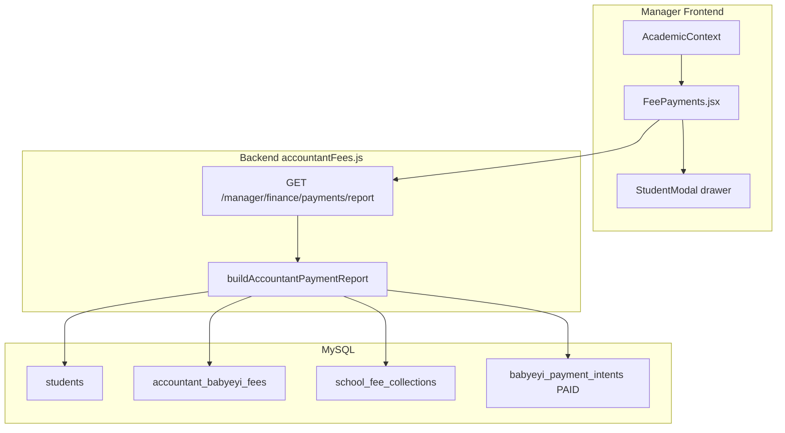

# Student Fee Payments — Architecture

## System overview



## Repository layout

```
babyeyipro/Frontend/web/src/manager/
├── PortalRoutes.jsx                 # finance/payments route
├── components/Sidebar.jsx           # Student Fee Payment nav
├── context/AcademicContext.jsx      # Default year / term
├── services/api.js                  # Axios client
└── pages/FeePayments.jsx            # ★ Main page + StudentModal

BabyeyiSystem/backend/
└── BabyeyiRoutes/accountantFees.js
    ├── buildAccountantPaymentReport()
    └── GET /manager/finance/payments/report
```

## Data flow (load registry)

1. Page seeds `selectedTerm` / `selectedYear` from `AcademicContext`.
2. `GET /manager/finance/payments/report?academic_year=&term=&class_name=&status=`
3. Server loads students → matches Babyeyi fee cards for **total due** → sums collections + optional online invoices for **paid** → derives status.
4. Frontend maps rows to UI model and computes KPI stats from the filtered list.

## Status model

| API status | UI label |
|------------|----------|
| `full_pay` / `full` | Fully Paid / Fully Settled |
| `remain_pay` | Partial |
| `not_paid` | Not Paid |
| `no_fee_card` | No Fee Card |

---

## Key frontend state

| State | Purpose |
|-------|---------|
| `students` | Mapped registry rows |
| `classes` | Class chip list from API |
| `selectedClass`, `selectedStatus`, `selectedTerm`, `selectedYear` | Filters |
| `searchTerm` | Client-side name/ID filter |
| `selectedStudent` | Opens detail drawer |
| `loading`, `error` | Fetch UX |
