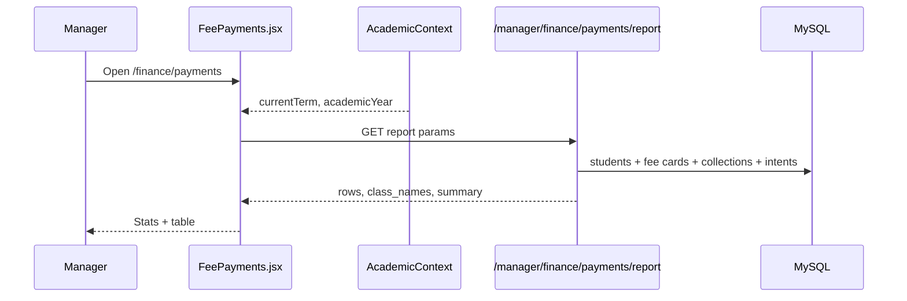

# 08 — Frontend–Backend Flow

## Load registry

## User filter change

1. Change term / year / class / status.  
2. `useEffect` deps fire → new GET with params.  
3. Replace `students` + `classes`.  
4. Client search reapplied on new list.

## Export path

1. User clicks Export CSV or Excel.  
2. Build rows from `filteredStudents`.  
3. Browser download (no server round-trip).

## Open drawer

1. Click table row.  
2. `selectedStudent` set.  
3. `StudentModal` portals over the page.

---

## Frontend design

Key deps on fetch effect: `[selectedClass, selectedStatus, selectedTerm, selectedYear]`.

Cancellation flag prevents stale responses when filters change quickly.

---

## Backend logic

Shared with Accountant reports via `buildAccountantPaymentReport` — keep manager and accountant status math identical when changing rules.
