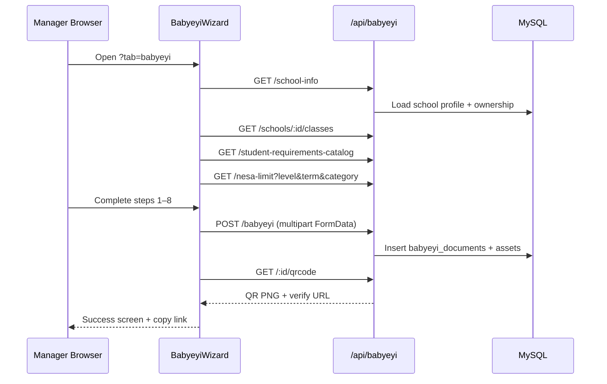

# Babyeyi Wizard — Architecture

## System overview

```mermaid
flowchart TB
  subgraph access [Access Control]
    SC[schoolConsoleAccess.js]
    PRO[pro_access_effective]
    PERM[pro.school_console.access]
  end

  subgraph wizard_ui [Manager Frontend]
    SUITE[SchoolLiteSuite.jsx]
    WIZ[Babyeyi.jsx - BabyeyiWizard]
    LIST[BabyeyiList.jsx]
    PDF[babyeyiPdfExport.js]
    DOC[babyeyiDocFrame.js]
  end

  subgraph shared [Shared Components]
    ELP[EducationLevelPicker]
    CSP[ClassStreamPicker]
    AC[AcademicContext]
    SCOPE[babyeyiWizardSchoolScope.js]
  end

  subgraph backend [BabyeyiSystem Backend]
    ROUTES[babyeyi.js]
    SCHEMA[babyeyiSchema.js]
    HTML[babyeyiDocHtml.js]
    PUP[babyeyiPuppeteerPdf.js]
  end

  subgraph external [External / Public]
    VERIFY[/babyeyi/verify/:docId]
    QR[QR scan → verify URL]
  end

  PRO --> SC
  PERM --> SC
  SC --> SUITE
  SUITE --> WIZ
  SUITE --> LIST
  WIZ --> ELP
  WIZ --> CSP
  WIZ --> AC
  WIZ --> SCOPE
  WIZ --> ROUTES
  LIST --> ROUTES
  LIST --> PDF
  LIST --> DOC
  ROUTES --> SCHEMA
  ROUTES --> HTML
  ROUTES --> PUP
  ROUTES --> VERIFY
  WIZ --> QR
```

---

## Repository layout

```
babyeyipro/Frontend/web/src/manager/
├── PortalRoutes.jsx                    # /manager/school-console route
├── config/
│   └── schoolConsoleNav.js             # Tab: babyeyi, babyeyi_list
├── utils/
│   └── schoolConsoleAccess.js          # canAccessSchoolConsole()
├── lib/
│   └── schoolLiteApi.js                # API_BASE, verify URL helpers
├── context/
│   └── AcademicContext.jsx             # academic year / term defaults
├── components/
│   ├── EducationLevelPicker.jsx
│   ├── ClassStreamPicker.jsx
│   └── RegisteredClassStreamPicker.jsx
├── pages/
│   ├── SchoolLiteSuite.jsx             # Tab shell
│   └── schoolLite/
│       ├── Babyeyi.jsx                 # ★ Main 8-step wizard (~3000 lines)
│       ├── BabyeyiList.jsx             # Registry, view, PDF, share
│       ├── BabyeyiPDF.jsx              # Public document viewer
│       ├── babyeyiWizardSchoolScope.js # Ownership → fee scope
│       ├── babyeyiPdfExport.js         # Client-side PDF capture
│       ├── babyeyiDocFrame.js          # HTML document template
│       ├── babyeyiDocFrameView.jsx     # React doc frame viewer
│       └── Dashboard.jsx               # Stats + NESA alerts
└── schoolLiteSupport/
    ├── i18n/                           # en.json, rw.json, fr.json
    ├── hooks/useBabyeyiUiT.js
    └── babyeyiDashboardTheme.js

BabyeyiSystem/backend/
├── BabyeyiRoutes/babyeyi.js            # All CRUD + wizard endpoints
├── utils/
│   ├── babyeyiSchema.js
│   ├── babyeyiDocHtml.js
│   └── babyeyiPuppeteerPdf.js
└── docs/postman/BabyeyiSystem.postman_collection.json
```

---

## Data flow: create Babyeyi



---

## Wizard modes

| Mode | Prop | Usage |
|------|------|-------|
| **Page** | `layout="page"` | Full-screen wizard at `?tab=babyeyi` |
| **Modal** | `layout="modal"` | Edit from `BabyeyiList` via `CreateBabyeyiModal` |

Both modes share the same `BabyeyiWizard` component and FormData payload.

---

## Key state in `BabyeyiWizard`

| State key | Purpose |
|-----------|---------|
| `step` | Current wizard step (1–8) |
| `form` | All form fields (payments, requirements, banks, leaders, etc.) |
| `schoolFeeScope` | `public` \| `private` \| `aided` \| `pending` |
| `schoolKind` | `government` \| `private` \| `government_aided` |
| `nesaLimit` | Fetched NESA fee ceiling (RWF) |
| `registeredClassOptions` | Classes from school registry |
| `studentReqCatalog` | Standard requirement checklist |
| `generatedQRCodes` | Post-submit QR results |
| `editId` | Non-null when editing existing record |

---

## Document lifecycle statuses

| Status | Meaning | PDF / WhatsApp |
|--------|---------|----------------|
| `draft` | Saved, not yet approved | Locked |
| `pending` | Awaiting district/NESA review | Locked |
| `approved` | Cleared for publication | Unlocked |
| Over NESA limit | Requires increase request approval | Locked until NESA approves increase |

See [BUSINESS_RULES.md](./BUSINESS_RULES.md) for full approval workflow.

---

## Environment & session

- **Auth:** Cookie session (`credentials: "include"`) shared with Pro manager portal.
- **API base:** `{VITE_API_URL}/api` — default `http://localhost:5100/api`.
- **Verify URL:** `VITE_BABYEYI_VERIFY_PUBLIC_URL` or current frontend origin.
- **Integrity hash:** First 16 hex chars appended as `?h=` on verify links.

---

## Legacy / unused files (do not wire new work here)

| File | Notes |
|------|-------|
| `UpdateBabyeyi.jsx` | Duplicate wizard (~2500 lines), not routed |
| `BabyeyiListServer.jsx` | Older list variant, not imported |
| `pages/BabyeyiWizard.jsx` | Finance prototype with mock data |
| `pages/BabyeyiHub.jsx` | Hub page, not routed in `PortalRoutes.jsx` |
