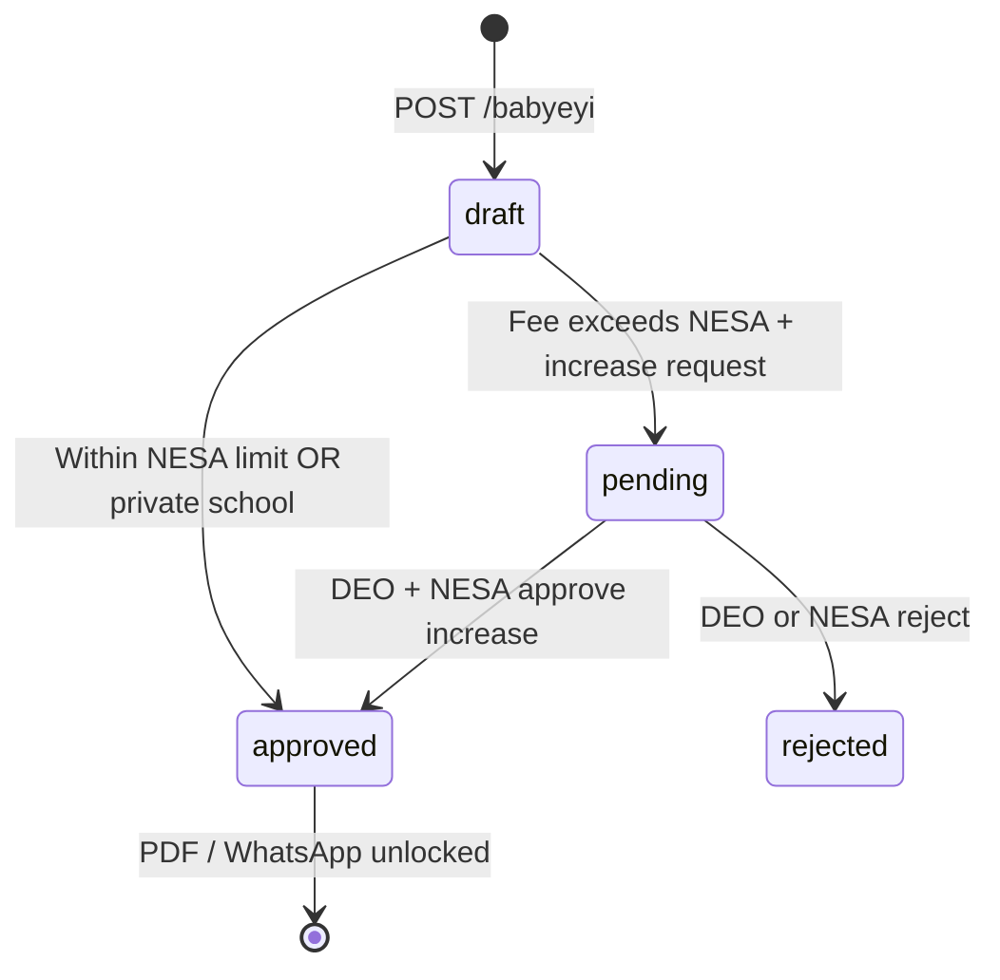

# Babyeyi Wizard — Business Rules

Rules governing NESA compliance, school ownership, fee categories, and document approval.

---

## School ownership → fee scope

Source: `babyeyiWizardSchoolScope.js` — `mapSchoolOwnershipToFeeScope()`

| `schools.ownership_type` | Fee scope | School kind | Default category | Category locked? |
|--------------------------|-----------|-------------|------------------|------------------|
| `Private` | `private` | `private` | Private | Yes |
| `Government` | `public` | `government` | Public | No (Public / Boarding) |
| `Government-Aided` | `aided` | `government_aided` | User picks cohort | No |

---

## Government-aided cohort picker

When `schoolKind === "government_aided"`, Step 1 shows a **Student cohort** selector:

| Cohort | `fee_target_students` | NESA Smart Checker | Category options |
|--------|----------------------|--------------------|------------------|
| Public students | `public` | **On** | Public, Boarding, TVET (NESA categories) |
| Private students | `private` | **Off** | Private only (locked) |

---

## Category options by school kind

Source: `categoryOptionsForWizard(schoolKind, feeTargetStudents)`

| School kind | Cohort | Allowed categories |
|-------------|--------|-------------------|
| Private | — | Private |
| Government | — | Public, Boarding |
| Government-Aided | public | NESA_SMART_CHECKER_CATEGORIES |
| Government-Aided | private | Private |

---

## NESA Smart Checker (Step 2)

The **Tuition Smart Checker** applies when `nesaApplies === true`:

```
nesaApplies =
  schoolFeeScope !== "private"
  AND form.feeTargetStudents !== "private"
```

### Limit lookup

1. `GET /api/babyeyi/nesa-limit?level=&term=&category=&district=`
2. Fallback: `GET /api/fee-limits`
3. Client-side defaults from `NESA_LIMITS` in `constants.js` if API returns none

### Validation

| Condition | Required action |
|-----------|-----------------|
| Total fee ≤ NESA limit | Submit normally |
| Total fee > NESA limit | Toggle **Request Increase Approval** ON |
| Increase request ON | Title, description, parent approval doc, school budget doc required |
| Exceeds limit, increase OFF | Block submit; show increase modal |

### Total fee calculation

Sum of all payment line `amount` values where `name` and `amount` are set.

---

## Payment & requirement pay channels

Each payment line and requirement row has `pay_channel`:

| Value | UI label | Meaning |
|-------|----------|---------|
| `babyeyi` | Other requirements | Not paid directly to school bank |
| `school` | Paid to School Account | Amount collected at school office |

Requirements with `pay_channel === "school"` also require a `cost` (RWF).

---

## Step validation gates

| Step | Gate before Next |
|------|------------------|
| 1 | At least one class selected; classes loaded |
| 2 | At least one payment item; NESA increase docs if over limit |
| 3–7 | No hard gates (optional content) |
| 8 (Submit) | Re-validates Step 2; requires `schoolId`; requires classes |

---

## Document approval workflow



### PDF & WhatsApp lock rules

Source: `BabyeyiList.jsx` — `isPdfWhatsappLocked(rec)`

| Scenario | Unlocked when |
|----------|---------------|
| Normal Babyeyi | `status === "approved"` |
| Over NESA limit | `status === "approved"` **AND** `increase_request.nesa_status === "approved"` |

---

## Multi-class Babyeyi

- Step 1 allows selecting **multiple classes** via `ClassStreamPicker`.
- One Babyeyi document is shared across all selected classes.
- `classes` sent as JSON array in FormData.
- Primary class = first selected class (used for NESA level inference).

---

## Asset persistence

Uploads via `POST /api/babyeyi/upload-asset` are saved to the **school profile**:

| Asset type | Wizard field | Reused on next Babyeyi |
|------------|--------------|------------------------|
| `logo` | schoolLogo | Yes |
| `signature` | directorSignature | Yes |
| `stamp` | stamp | Yes |

Logo/signature/stamp loaded from profile on wizard open via `/school-info`.

---

## QR verification

After successful save:

1. `GET /api/babyeyi/:id/qrcode` returns QR image + view URL.
2. Verify URL format: `{BABYEYI_VERIFY_PUBLIC_ORIGIN}/babyeyi/verify/{docId}?h={hash16}`
3. Public page validates document integrity via stored hash.

---

## Roles: Kinyarwanda content edit

`BabyeyiList.jsx` allows PATCH of Kinyarwanda narrative fields for:

- MANAGER, SCHOOL_MANAGER, SCHOOL_ADMIN, HEAD_TEACHER, DIRECTOR, PRINCIPAL, ADMIN

Endpoint: `PATCH /api/babyeyi/:id/content-i18n/rw`
