# Babyeyi Wizard — Documentation Hub

> **Portal path:** `/manager/school-console?tab=babyeyi`  
> **Code (frontend):** `babyeyipro/Frontend/web/src/manager/pages/schoolLite/Babyeyi.jsx`  
> **Code (backend):** `BabyeyiSystem/backend/BabyeyiRoutes/babyeyi.js`  
> **List & registry:** `babyeyipro/Frontend/web/src/manager/pages/schoolLite/BabyeyiList.jsx`

The **Babyeyi Wizard** is the school fee-document builder inside the **Pro Manager Portal**. School managers create, edit, and publish official **Babyeyi** documents — structured fee schedules with payments, requirements, bank details, authorization assets, leadership contacts, QR verification, and PDF export.

---

## Quick start (developers)

```bash
# Backend
cd BabyeyiSystem/backend
npm install
npm run dev          # http://localhost:5100

# Frontend
cd babyeyipro/Frontend/web
npm install
npm run dev          # http://localhost:5174/manager/school-console?tab=babyeyi
```

Set in `.env`:

| Variable | Purpose |
|----------|---------|
| `VITE_API_URL` | Backend origin (default `http://localhost:5100`) |
| `VITE_BABYEYI_VERIFY_PUBLIC_URL` | Public verify URL for QR scans (production) |
| `VITE_BABYEYI_LOGIN_URL` | Login redirect for public verify flow |

**Access:** School must have `pro_access_effective`, or user must hold permission `pro.school_console.access` (or `*`).

---

## Documentation index

### Feature guides (step-by-step)

| Document | Description |
|----------|-------------|
| [**FEATURES_INDEX.md**](./FEATURES_INDEX.md) | Chapter hub + learning path |
| [**FEATURES_COMPLETE.md**](./FEATURES_COMPLETE.md) | **All features in one manual** (Word-friendly) |
| [**features/**](./features/) | One guide per wizard step + list/registry |

### Technical reference

| Document | Description |
|----------|-------------|
| [**00-architecture.md**](./00-architecture.md) | System diagram, data flow, file map |
| [**DEVELOPER_GUIDE.md**](./DEVELOPER_GUIDE.md) | Code layout, extending the wizard, pitfalls |
| [**API_REFERENCE.md**](./API_REFERENCE.md) | All `/api/babyeyi*` endpoints used by the wizard |
| [**BUSINESS_RULES.md**](./BUSINESS_RULES.md) | NESA limits, ownership, approval workflow |
| [**DOC_STANDARDS.md**](./DOC_STANDARDS.md) | How to write or extend these docs |

### Related docs elsewhere

| Location | Coverage |
|----------|----------|
| [BabyeyiSystem/docs/postman/BabyeyiSystem.postman_collection.json](../../../BabyeyiSystem/docs/postman/BabyeyiSystem.postman_collection.json) | Postman collection — **06 - Babyeyi Core** |
| [BabyeyiSystem/docs/API_REFERENCE.md](../../../BabyeyiSystem/docs/API_REFERENCE.md) | Full backend API reference |
| `manager/schoolLiteSupport/i18n/*.json` | List/document UI strings (en, rw, fr) |

---

## Wizard workflow (high level)

```mermaid
flowchart LR
  A[Step 1: School & Classes] --> B[Step 2: Payments + NESA]
  B --> C[Step 3: Requirements]
  C --> D[Step 4: Bank Account]
  D --> E[Step 5: Authorization]
  E --> F[Step 6: Class Notes]
  F --> G[Step 7: Leaders]
  G --> H[Step 8: Preview & Submit]
  H --> I[POST /api/babyeyi]
  I --> J[QR + Success Screen]
  J --> K[Babyeyi List — View / PDF / Share]
```



| Step | User action | Tab / route |
|------|-------------|-------------|
| 1 | Set academic year, term, category, classes, location | `?tab=babyeyi` step 1 |
| 2 | Add payment lines; NESA Smart Checker validates total | step 2 |
| 3 | Select catalog requirements + custom items | step 3 |
| 4 | Primary + additional bank accounts | step 4 |
| 5 | Upload signature & stamp (persisted to school profile) | step 5 |
| 6 | Other school information notes | step 6 |
| 7 | School leadership contacts | step 7 |
| 8 | Review summary, submit, generate QR | step 8 |
| — | Manage records, PDF, WhatsApp, i18n edit | `?tab=babyeyi_list` |

---

## School console tabs

| Tab | URL param | Component |
|-----|-----------|-----------|
| Dashboard | `?tab=dashboard` | `schoolLite/Dashboard.jsx` — stats, NESA alerts |
| **Babyeyi Wizard** | `?tab=babyeyi` | `schoolLite/Babyeyi.jsx` — 8-step wizard |
| **Babyeyi List** | `?tab=babyeyi_list` | `schoolLite/BabyeyiList.jsx` — registry |
| Students | `?tab=students` | `schoolLite/StudentsPage.jsx` |
| Student Transfer | `?tab=student_transfer` | `schoolLite/StudentTransferPage.jsx` |
| School Website | `?tab=school_mini_website` | `schoolLite/SchoolMiniWebsitePage.jsx` |

---

## Key files (quick reference)

| Layer | File |
|-------|------|
| Main wizard UI | `manager/pages/schoolLite/Babyeyi.jsx` |
| Ownership / NESA scope | `manager/pages/schoolLite/babyeyiWizardSchoolScope.js` |
| List + view modal + PDF | `manager/pages/schoolLite/BabyeyiList.jsx` |
| PDF export (client) | `manager/pages/schoolLite/babyeyiPdfExport.js` |
| Document HTML frame | `manager/pages/schoolLite/babyeyiDocFrame.js` |
| School console shell | `manager/pages/SchoolLiteSuite.jsx` |
| Access gate | `manager/utils/schoolConsoleAccess.js` |
| API client helpers | `manager/lib/schoolLiteApi.js` |
| Class picker | `manager/components/ClassStreamPicker.jsx` |
| Education level picker | `manager/components/EducationLevelPicker.jsx` |
| Academic year/term | `manager/context/AcademicContext.jsx` |
| Backend routes | `BabyeyiSystem/backend/BabyeyiRoutes/babyeyi.js` |
| DB schema | `BabyeyiSystem/backend/utils/babyeyiSchema.js` |

---

## Important note: two wizard implementations

| Route | Component | Status |
|-------|-----------|--------|
| `/manager/school-console?tab=babyeyi` | `schoolLite/Babyeyi.jsx` | **Production** — full 8 steps + API |
| `/manager/finance/wizard` | `pages/BabyeyiWizard.jsx` | **Prototype** — mock data, steps 3–7 stubbed |

Developers should treat **`schoolLite/Babyeyi.jsx`** as the canonical implementation.

---

## Export to Word

Open `FEATURES_COMPLETE.md` in Microsoft Word, or:

```powershell
cd babyeyipro/docs/babyeyi-wizard
pandoc FEATURES_COMPLETE.md -o Babyeyi-Wizard-Manual.docx
```

---

*Babyeyi Wizard Module — Pro Manager Portal*
