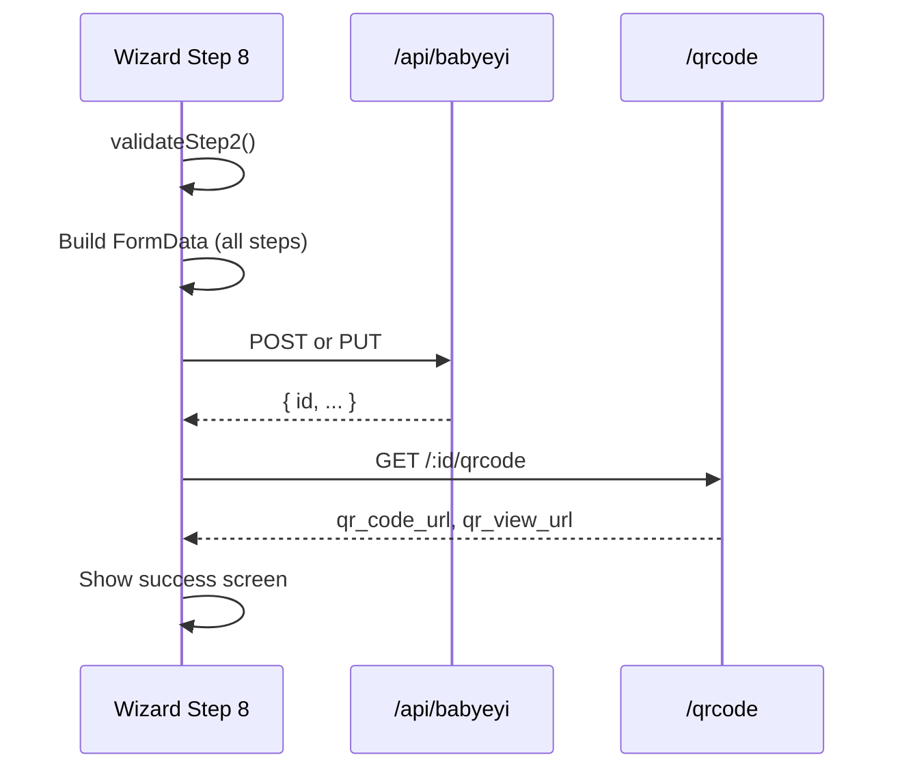

# 09 — Preview & Submit (Step 8)

Step 8 shows a summary of all entered data, validates the form, submits to the API, and displays the success screen with QR codes.

---

## Features

| Feature | Description |
|---------|-------------|
| **Summary cards** | Classes, total fee, NESA status, bank, leaders count |
| **Document preview** | Live preview of official Babyeyi layout |
| **Validation checklist** | Visual pass/fail for required sections |
| **Submit button** | POST (create) or PUT (edit) multipart FormData |
| **QR code generation** | Fetched from server after save |
| **Success screen** | Confirmation with class list and fee total |
| **Copy verify link** | Clipboard copy of public verify URL |
| **Create Another** | Reset wizard for new document |
| **Modal close** | Returns to list after edit save |

---

## Frontend design

| Item | Detail |
|------|--------|
| **Component** | `Babyeyi.jsx` → `renderStep()` case 8 + success screen |
| **Save handler** | `handleSave()` |
| **QR fetch loop** | `GET /babyeyi/:id/qrcode` per created record |

### Submit flow



### Success screen elements

| Element | Description |
|---------|-------------|
| Checkmark hero | Amber gradient icon |
| Class summary | List of created/updated classes |
| QR grid | One QR per record (multi-class) |
| Copy link button | Copies verify URL to clipboard |
| Summary grid | School, year, term, total fee, bank, status |
| Create Another | Resets form to blank state |

### Edit mode differences

| Mode | After save |
|------|------------|
| Page (create) | Success screen with QR |
| Modal (edit) | Calls `onSuccess()` + `onClose()`, no success screen |

---

## Backend logic

| Endpoint | Method | Purpose |
|----------|--------|---------|
| `/babyeyi` | POST | Create new document |
| `/babyeyi/:id` | PUT | Update existing |
| `/babyeyi/:id/qrcode` | GET | QR after save |

### Response handling

```js
const savedId = json.data?.id || editId;
// Then fetch QR for savedId
```

### Error cases

| Error | User message |
|-------|--------------|
| Missing schoolId | "School ID missing from session." |
| No classes | "Select at least one class before submitting." |
| NESA exceed, no increase | Increase modal + toast |
| API failure | Server `detail` or `message` in toast |

### Status after submit

| Condition | Display status |
|-----------|----------------|
| Private school or no NESA | "✅ Submitted" |
| Within NESA limit | "✅ Approved" (UI label) |
| Over limit + increase ON | "⏳ Pending" |

Actual DB status set by backend based on fee and approval rules.
