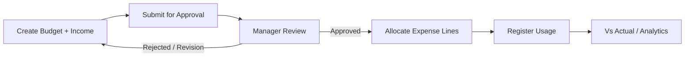

# Accountant School Budget — Documentation Hub

> **Portal path:** `/accountant/school-budget`  
> **Sidebar:** Finance Management → **School Budget**  
> **UI root:** `accountant_portal/frontend/src/pages/schoolBugdet.jsx` *(filename typo: Bugdet)*  
> **Backend:** `BabyeyiSystem/backend/BabyeyiRoutes/portalOperations.js`  
> **Manager approvals:** `/manager/finance/budgets`

Modern developer documentation for the **School Budget** module — create budgets, allocate expenses, track usage, analyze vs actual, and manage manager approvals.

---

## Quick start

```bash
# Backend
cd BabyeyiSystem/backend && npm run dev   # :5100

# Frontend
cd babyeyipro/Frontend/web && npm run dev
# Open: http://localhost:5174/accountant/school-budget
```

**Roles:** Accountant (create/submit/allocate/usage) · School Manager / Admin (approve/reject/freeze).

---

## Documentation index

### Feature guides

| Document | Description |
|----------|-------------|
| [**FEATURES_INDEX.md**](./FEATURES_INDEX.md) | Chapter hub + learning path |
| [**FEATURES_COMPLETE.md**](./FEATURES_COMPLETE.md) | All features in one manual |
| [**features/**](./features/) | Step-by-step chapters |

### Technical

| Document | Description |
|----------|-------------|
| [**00-architecture.md**](./00-architecture.md) | System diagram, tables, page map |
| [**DEVELOPER_GUIDE.md**](./DEVELOPER_GUIDE.md) | Onboarding, extending pages |
| [**API_REFERENCE.md**](./API_REFERENCE.md) | REST endpoints |
| [**BUSINESS_RULES.md**](./BUSINESS_RULES.md) | Statuses, allocation, usage limits |
| [**BACKEND_LOGIC.md**](./BACKEND_LOGIC.md) | Server create/submit/review/usage |
| [**DOC_STANDARDS.md**](./DOC_STANDARDS.md) | How to extend these docs |

---

## Nested pages (in-module nav)

| Page id | Label |
|---------|-------|
| `budget-dashboard` | Dashboard |
| `create-budget` | Create Budget |
| `budget-lines` | Expenses |
| `budget-usage-tracking` | Usage Tracking |
| `dept-budgets` | Department Budgets |
| `budget-vs-actual` | Budget vs Actual |
| `approvals` | Approvals |
| `analytics` | Analytics |
| `balance-sheet` | Balance Sheet |
| `audit-logs` | Audit Logs |

Sub-pages are **state-switched** inside `schoolBugdet.jsx` (not separate React Router paths).

---

## High-level workflow



---

## Key files

| Layer | Path |
|-------|------|
| Shell | `pages/schoolBugdet.jsx` |
| Nav | `utils/schoolBudgetNav.js` |
| Context | `context/SchoolBudgetDataContext.jsx` |
| Budget API | `services/schoolBudgetApi.js` |
| Lines / usage API | `services/budgetLineApi.js` |
| Income engine | `utils/budgetIncomeConfig.js` |
| Manager UI | `manager/pages/budget/SchoolBudgetManagement.jsx` |
| Backend | `portalOperations.js` (school-budgets section) |

---

## Related modules

| Module | Link |
|--------|------|
| Manager School Budget Management | Approvals + freeze lines |
| Action Plan → Budget Tracking | Activities link to budget lines |
| Babyeyi Fee Cards | Tuition income auto-fill |

---

## Export to Word

```powershell
cd babyeyipro/docs/accountant-school-budget
pandoc FEATURES_COMPLETE.md -o word/School-Budget-Complete-Manual.docx --toc --toc-depth=3
pandoc README.md 00-architecture.md DEVELOPER_GUIDE.md BACKEND_LOGIC.md API_REFERENCE.md BUSINESS_RULES.md -o word/School-Budget-Developer-Pack.docx --toc --toc-depth=2
```

---

*Accountant Portal — School Budget*
