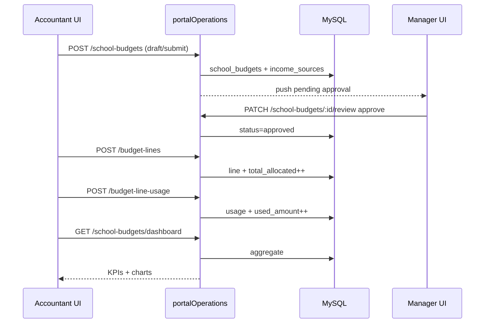

# Chapter 10 — Frontend–Backend Flow

## End-to-end happy path

---

## Data path by page

| Page | Client | Primary endpoints |
|------|--------|-------------------|
| Dashboard | `schoolBudgetApi` + context | `GET …/dashboard` |
| Create Budget | `schoolBudgetApi` | options, POST/PATCH budgets, fee analysis |
| Expenses | `budgetLineApi` | lines, summary, options, POST lines |
| Usage | `budgetLineApi` | POST/GET usage |
| Approvals (acct) | context only | (display) |
| Approvals (mgr) | `managerBudgetApi` | review, freeze, overview |
| Dept / Vs Actual / Analytics | context | derived |
| Action Plan Budget | `actionPlanApi` | activity expense |

---

## Context load pattern

`SchoolBudgetDataContext`:

1. Load budget list / options.  
2. Resolve `budgetId` (selection or active).  
3. Fetch dashboard + lines (+ income).  
4. Derive alerts, department series, monthly series.  
5. Expose `reload()` after mutations.

---

## Auth

| Layer | Mechanism |
|-------|-----------|
| Browser | Session cookie via `services/api` |
| Routes | `requireRole(ACCOUNTANT_READ_ROLES / WRITE_ROLES)` |
| Review / freeze | Manager / Admin roles |

---

## Totals consistency

| Field | Updated when |
|-------|--------------|
| `total_expected_income_rwf` | Create/update income sources |
| `total_allocated_rwf` | Create (and ideally update) lines |
| `used_amount_rwf` (line) | Register usage / linked activity expense |

Always keep: `allocated ≤ expected` and `used ≤ planned` (per line).
