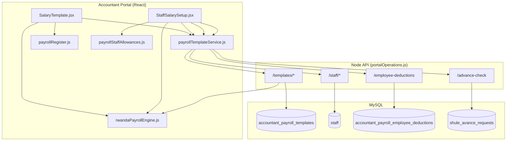

# 09 — Frontend & Backend Flow

Complete request/response and calculation pipeline for Salary Template and Staff Salary Setup.

> Naming convention: all docs use **Frontend design** and **Backend logic** per [DOC_STANDARDS](../DOC_STANDARDS.md).

---

## Frontend design (architecture)



---

## Salary Template — full lifecycle

### 1. Page load

| Layer | Code | Detail |
|---|---|---|
| UI | `SalaryTemplate` `useEffect` | Calls `loadTemplate()` |
| Service | `getActivePayrollTemplate()` | GET `/accountant/payroll/templates/active` |
| Service | `getEmployeePayrollDeductions()` | GET `/accountant/payroll/employee-deductions` |
| API | `portalOperations.js` | SELECT template + deductions for `schoolId` |
| UI | `mapAllowanceFromApi`, `mapDeductionFromApi` | Hydrate React state |

### 2. Save / activate

| Layer | Code | Detail |
|---|---|---|
| UI | `persistTemplate(action)` | Builds payload from state |
| Service | `savePayrollTemplate(payload)` | POST `/accountant/payroll/templates` |
| API | Transaction | `deactivate` / `update` / `save_draft` / `activate` / INSERT new version |
| DB | `accountant_payroll_templates` | JSON columns updated |
| DB | `accountant_payroll_template_versions` | Snapshot on new version INSERT |
| API | `appendAuditLog()` | Audit trail entry |

### 3. Statutory live register (client-only)

```
searchPayrollStaff("", 500)
  → for each staff.payroll.basicSalary > 0:
      calcRwandaPayroll(...)
      buildPayrollRegisterRow(meta, calc)
  → PayrollRegisterTable
```

No dedicated register API — preview is computed in browser.

---

## Staff Salary Setup — full lifecycle

### 1. Page load

```javascript
// loadStaff()
const [rows, tpl] = await Promise.all([
  searchPayrollStaff("", 500),
  getActivePayrollTemplate(),
]);
setAllowanceRules(tpl?.rules?.allowanceAuto);
setTemplateStatutory(normalizeStatutoryRates(tpl.statutory));
setTemplatePayeRates(tpl.payeRates);
// Map rows → salaries[staffId] from payroll columns
```

### 2. Select staff

```javascript
// loadStaffDeductions(staffId)
const [dedRows, advanceCheck] = await Promise.all([
  getEmployeePayrollDeductions({ staffUserId }),
  getStaffAdvanceCheck(staffId),
]);
// Split into customDeductions[] and advances[]
// Merge Shule Avance from advanceCheck.approvedAdvances
```

### 3. Live preview (every keystroke)

**Normal mode:** inline `gross`, `calcPAYE`, statutory approximations in component.

**Net-to-Gross mode:** `calcNetToGrossFromDesiredNet()` → `salaryFromNetToGrossResult()`.

For production payroll run, backend uses full `calcRwandaPayroll()` — Staff Setup preview is for package editing.

### 4. Save

```javascript
saveStaffPayrollProfile(userId, buildStaffAllowancePayload(sal, allowanceRules));
```

| API field | DB column |
|---|---|
| `payroll_basic_salary` | `staff.payroll_basic_salary` |
| `payroll_transport_allowance` | `staff.payroll_transport_allowance` |
| `payroll_housing_allowance` | `staff.payroll_housing_allowance` |
| `payroll_meal_allowance` | `staff.payroll_meal_allowance` |
| `payroll_other_allowances` | `staff.payroll_other_allowances` (JSON) |

---

## Employee deductions CRUD

| Action | Frontend function | HTTP | SQL |
|---|---|---|---|
| List all | `getEmployeePayrollDeductions()` | GET | SELECT by school_id |
| List one staff | `getEmployeePayrollDeductions({ staffUserId })` | GET ?staffUserId= | filtered SELECT |
| Create | `createEmployeePayrollDeduction()` | POST | INSERT |
| Update | `updateEmployeePayrollDeduction(id)` | PATCH | UPDATE fields |
| Delete | `deleteEmployeePayrollDeduction(id)` | DELETE | SET deleted_at |

Used by:
- Salary Template → Employee Deductions tab
- Staff Salary Setup → Deductions + Advance tabs

---

## Advance-check (Shule Avance)

```
GET /accountant/payroll/advance-check/:staffUserId
```

Backend:
1. SELECT approved `shule_avance_requests` for teacher.
2. SELECT paid payroll periods from `payroll_requests`.
3. Compute `paidInstallments`, `remainingMonths`, `monthlyPayment`, `remainingBalance`.
4. Return `approvedAdvances[]` for UI display.

---

## Payroll calculation engine

**Single source of truth:** `rwandaPayrollEngine.js`

| Function | Used by |
|---|---|
| `calcRwandaPayroll()` | Statutory tab, Payroll Run, preview API |
| `calcProgressivePAYEBreakdown()` | PAYE detail table |
| `calcNetToGrossFromDesiredNet()` | Staff Setup net-to-gross |
| `calcSchoolAllowancesFromBasic()` | Auto Others/H/A/T/A |
| `normalizeStatutoryRates()` | Template load |
| `shouldUseSchoolAutoAllowances()` | Engine allowance mode |

Backend preview route imports same calc for parity:

```javascript
// POST /accountant/payroll/templates/preview
const result = calcRwandaPayroll({ ...req.body });
```

---

## Auth and tenancy

Every route uses `req.ctx.schoolId` from authenticated session.

| Role set | Typical access |
|---|---|
| `ACCOUNTANT_READ_ROLES` | GET template, staff search, deductions |
| `ACCOUNTANT_WRITE_ROLES` | POST/PATCH template, staff profile, deductions |

---

## File reference

| File | Responsibility |
|---|---|
| `SalaryTemplate.jsx` | 4 tabs, template persistence, live register |
| `StaffSalarySetup.jsx` | Per-staff editor, modes, modals |
| `payrollTemplateService.js` | Axios API wrapper |
| `payrollStaffAllowances.js` | `mergeRegisterAllowanceAmounts` |
| `payrollRegister.js` | Register row build + export |
| `portalOperations.js` | All REST handlers (~lines 3770–5555) |

---

## Next

- [10 — Validation & QA](./10-validation-and-qa.md)
- [FEATURES_COMPLETE.md](../FEATURES_COMPLETE.md)
